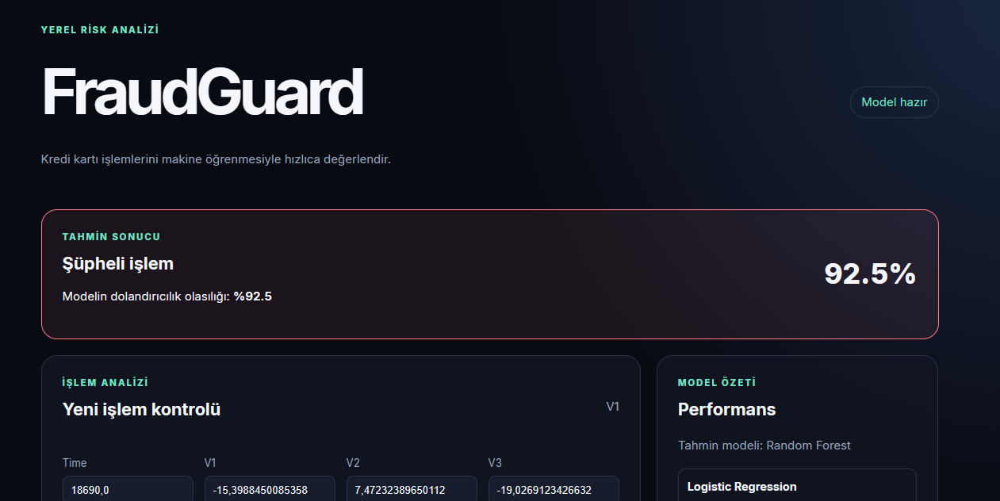

# Kredi Kartı Dolandırıcılık Tespiti

## Problem
Günümüzde dijital bankacılık ve online alışverişlerin artmasıyla birlikte finansal dolandırıcılık vakaları da hızla artmaktadır. Kredi kartı sahiplerinin bilgileri dışında yapılan hileli işlemler hem bireysel kullanıcılar hem de finansal kurumlar için büyük maddi kayıplara ve güvenlik açıklarına yol açmaktadır. Manuel olarak milyonlarca işlemi anlık incelemek imkansızdır; bu durum otomatik ve hızlı bir tespit mekanizmasına duyulan ihtiyacı ortaya koymaktadır.

## Hedef Kullanıcı
* Bankalar ve finansal kuruluşların risk yönetimi ve güvenlik birimleri

* E-ticaret platformlarının sahtekarlık önleme ekipleri

* Kredi kartı kullanıcılarının güvenliğini sağlamakla sorumlu yazılım sistemleri

  

## Proje Amacı
Bu projenin amacı, gerçekleştirilen bir finansal işlemin şüpheli olup olmadığını makine öğrenmesi algoritmaları kullanarak otomatik olarak tespit edebilen, güvenilir ve modüler bir yazılım altyapısı geliştirmektir. Projede Logistic Regression, Decision Tree ve Random Forest Regression yöntemleri kullanılarak modellerin başarımları karşılaştırılacaktır.

## Kapsam
* Kaggle üzerindeki Credit Card Fraud Dataset veri setinin incelenmesi ve veri analizi yapılması

* Dengesiz veri seti problemi için gerekli ön işleme adımlarının uygulanması

* Logistic Regression, Decision Tree ve Random Forest modellerinin eğitilmesi ve test edilmesi

* Model performanslarının sadece Accuracy metriğiyle değil de Precision, Recall, F1-Score ve ROC-AUC metrikleriyle değerlendirilmesi

* Modellerin her biriyle uygulamalar yapılıp performanslarının ve başarı oranlarının karşılaştırılması, raporlanması

* Modüler bir yazılım mimarisi (src/, notebooks/, data/) oluşturulması

  

## Kapsam Dışı
* Derin öğrenme (Deep Learning / Neural Networks) veya XGBoost, LightGBM gibi ileri düzey topluluk (ensemble) algoritmalarının bu aşamada projeye dahil edilmesi

* Gerçek zamanlı canlı bir API entegrasyonunun yapılması

## Veri Seti
* [Kaggle Credit Card Fraud Detection Dataset](https://www.kaggle.com/datasets/mlg-ulb/creditcardfraud)
  

## Proje Diyagramları ve Uygulama İşleyişi
[📄 Proje Use Case Diyagramı (PDF)](ProjeUseCaseDiyagrami.pdf)

* Bu diyagram, ekip üyelerinin (Naz, Kaan, Kerem) proje boyunca üstlendiği görev dağılımını ve sistemle olan etkileşimlerini göstermektedir.

[📄 Proje Class Diyagramı (PDF)](ProjeClassDiyagrami.pdf)

* Sınıf diyagramı, yazılımın nesne yönelimli mimarisini iki ana pakette (Süreç ve Takım Yönetimi ve Makine Öğrenmesi) incelemektedir. ProjeYonetimi ve EkipUyesi sınıfları sprint ve görev takibini sağlarken; VeriYoneticisi, ModelEgiticisi ve ModelDegerlendirici sınıfları veri yükleme, SMOTE dengeleme, model eğitme (Logistic Regression, Decision Tree vb.) ve metrik hesaplama (Accuracy, F1, ROC-AUC) operasyonlarını yürütmektedir. Bu sınıflar, projenin yazılım mühendisliği prensiplerine uygun modüler yapısını temsil eder.

[📄 Proje Activity Diyagramı (PDF)](ProjeActivityDiyagrami.pdf)

* Aktivite diyagramı, projenin gereksinim analiziyle başlayıp model eğitimi, başarı ölçümleri ve raporlamayla biten adım adım iş akışını görselleştirmektedir. Süreç, literatür taraması ve veri ön işleme adımlarıyla beslenmekte, ardından ardışık olarak model kodlanması ve hata analizleriyle tamamlanmaktadır. Bu akış, projenin sistematik bir metodolojiyle ilerlediğini ortaya koymaktadır.
  
[📄 Uygulama İşleyişi (PDF)](Uygulamaİsleyisi.pdf)

* Bu akış şeması, sistemin çalışma anındaki anlık karar mekanizmasını özetlemektedir. Kullanıcıdan alınan işlem bilgileri analiz edilerek dolandırıcılık olasılığı hesaplanmaktadır. İşlem normal ise onaylanmakta, şüpheli olarak tespit edildiğinde ise otomatik bildirim gönderilerek engelleme mekanizması devreye girmektedir.

## Literatür

**Makale Bağlantısı:** [Denetimli Makine Öğrenmesi ile Kredi Kartı Sahteciliği Tespiti (PDF)](https://github.com/user-attachments/files/34531148/10.26650-JEPR1433315-3713306.pdf)

* Kısa Özet: Bu çalışmada, bir kamu bankasına ait 13.050 gerçek kredi kartı işlemi incelenmiş; Python kullanılarak Lojistik Regresyon, Karar Ağaçları, Rassal Orman ve Gradyan Güçlendirme algoritmaları test edilmiştir. Çalışma sonucunda Karar Ağacı algoritmasının %93.1 doğruluk oranıyla en az hatalı tahmini yapan model olduğu kanıtlanmıştır.

* Projeye Gerekçesi: Literatürdeki bu sonuç doğrultusunda, projemizde gerçek veri setleri üzerinde yüksek başarı gösteren ağaç tabanlı sınıflandırma algoritmalarını (Karar Ağacı ve Rassal Orman) benimseme kararımız akademik olarak gerekçelendirilmiştir.

**Makale Bağlantısı:** [Kredi Kartı Dolandırıcılık Tespitinde Makine Öğrenme Algoritmalarının Karşılaştırmalı Analizi (PDF)](https://github.com/user-attachments/files/34531316/Tam.Metin._.Full.Text.pdf)

* Kısa Özet: Bu çalışmada, 284.807 işlem içeren kredi kartı veri kümesindeki sınıf dengesizliği SMOTE yöntemi ile giderilmiş; Lojistik Regresyon, Destek Vektör Makineleri, Karar Ağaçları, Rastgele Orman ve Yapay Sinir Ağları (ANN) test edilmiştir. Çalışma sonucunda Yapay Sinir Ağları %99.94 doğruluk oranıyla en yüksek başarıyı sağlarken, Karar Ağaçları ve Rastgele Orman modellerinin de yüksek doğruluk, dengeli sonuçlar ve açıklanabilirlik sunduğu kanıtlanmıştır.

* Projeye Gerekçesi: Literatürdeki bu sonuç doğrultusunda, projemizde veri dengesizliğini gidermek için SMOTE yöntemini benimseme ve yüksek başarı gösteren ağaç tabanlı ile derin öğrenme modellerini kullanma kararımız akademik olarak gerekçelendirilmiştir.

**Makale Bağlantısı:** [Kartlı Ödeme Sistemlerinde Dolandırıcılık: Türler, Tehdit Analizi ve Önleme Stratejileri (PDF)](https://github.com/user-attachments/files/34531404/KARTLI.ODEME.SISTEMLERINDE.DOLANDIRICILIK_.TURLER.TEHDIT.ANALIZI.VE.ONLEME.STRATEJILERI.1973689.-6122514.pdf)

* Kısa Özet: Bu çalışmada, kartlı ödeme sistemlerindeki dolandırıcılıklar ATM, kart, üye işyeri ve dijital/uzaktan kanallar (CNP, SIM swap, dijital cüzdan) olmak üzere sistematik bir taksonomiyle sınıflandırılmış; risk matrisi ve PCI-DSS/EMV standartlarını içeren çok katmanlı koruma çerçevesi sunulmuştur.
  
* Projeye Gerekçesi: Literatürdeki bu kapsamlı sektörel tehdit analizi, projemizin iş gereksinimleri, risk yönetimi ve sistem güvenlik standartlarının gerçek dünya regülasyonlarına uyumlu şekilde modellenmesini sağlamıştır.

## Ekip ve Roller  

Çevik proje geliştirme yönteminin prensiplerine uygun olacak şekilde her ekip üyesi projenin her aşamasında aktif rol oynamaktadır. Projedeki temel sorumluluk alanları ise aşağıda açıklandığı şekilde dağıtılmıştır.

* **Naz   [[@Th3BourbonKid]](https://github.com/Th3BourbonKid) - Dokümantasyon Sorumlusu & İş Analisti:**
Literatür taramasının yönetilmesi, proje dokümantasyonunun oluşturulması, proje gereksinimlerinin belirlenmesi, proje ara raporlarının ve final raporunun hazırlanması, diyagramların oluşturulması.

* **Kerem   [[@kerem-vi]](https://github.com/kerem-vi) - Yazılımcı & Test Uzmanı:**
Logistic Regression, Decision Tree ve Random Forest modellerinin kodlanması, model eğitimlerinin ve parametre optimizasyonlarının yapılması.
Model başarı metriklerinin ölçülmesi, modeller arası karşılaştırmalar yapılıp belgelenmesi, hata analizleri.

* **Kaan   [[@kaanardakaba]](https://github.com/kaanardakaba) - Süreç Yöneticisi & Veri Analisti:**
Proje Kanban panosunun ve iş akışının yönetilmesi, README dosyasının güncel tutulması, repo düzeni, veri setinin incelenmesi ve keşifsel veri analizi, gerekli ön işleme adımlarının uygulanması.

## Proje Arayüz

